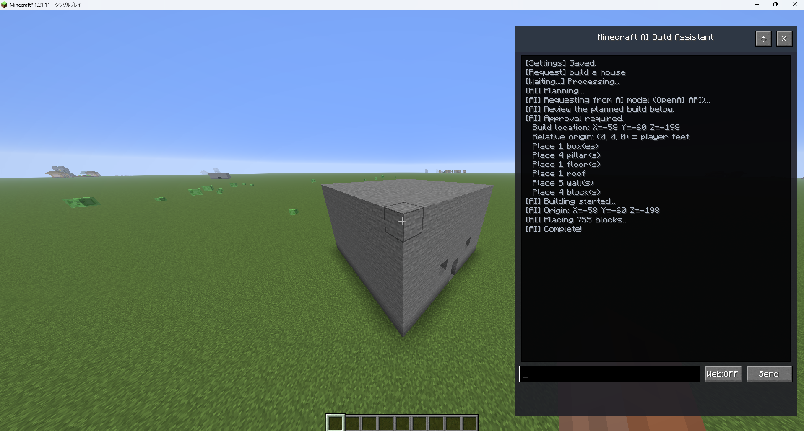

# AI Build Assistant NF (Minecraft 1.20.1 Forge / NeoForge)

Describe a building, an object or a piece of equipment in plain words, and an AI designs it in your
Minecraft world: buildings out of blocks, small objects and equipment out of display pieces.

이 저장소는 AI Build Assistant(1.21.4 Fabric, [McTestBuilder](https://github.com/foredayner/McTestBuilder))를
**Minecraft 1.20.1 Forge**로 옮긴 버전이에요. 같은 jar가 **NeoForge 1.20.1**에서도 돌아가요(CI에서 둘 다 확인).



## Install

| Component | Version |
| --- | --- |
| Minecraft | 1.20.1 |
| Loader | Forge 47.x, or NeoForge 47.1.x |
| Java | 17 |

1. Get the jar from the [latest release](https://github.com/foredayner/McTestBuilderNF/releases/tag/mc1.20.1-latest)
   (or build it: `./gradlew build`).
2. Put it into `mods/` on the server **and** on every player's game. Nothing else is needed.
3. Operators (permission level 2) press **O** in game to open the AI 공방. In singleplayer, turn cheats on.

## What it does

- **AI providers**: Ollama (local), OpenAI, Claude, or a custom HTTP endpoint (Settings in the AI 공방).
- **Buildings**: the AI writes a Groovy build script (run in a locked-down sandbox, reviewed and dry-run
  first), then the build is placed block by block. Undo is one click.
- **Objects**: smooth shapes painted into a fine voxel grid and drawn with display entities; solid to walk on;
  kept as items you can place and mine back.
- **Equipment**: swords, axes, bows, staffs... and worn pieces (helmets, hats, armour, back items), drawn as
  the AI's 3D model, with iron stats of their kind, optional colour-dot effects and attack motions.
- **보관함**: every design is saved; take any of them out again as a blueprint, object item or gear item.
- **Multiplayer**: talking to the AI and changing settings is for operators only (checked by the server);
  everyone can use what was made.

Details of the features: [PORT-1.21.4.md](PORT-1.21.4.md). What changed for 1.20.1: [PORT-1.20.1.md](PORT-1.20.1.md).

## Development

```
./gradlew build                       # compile, unit tests, jar
./gradlew runClient                   # play in a dev game
./gradlew runGameTestServer           # in-world server tests
./gradlew runSmokeClient              # client screenshots (needs a display)
./gradlew build runGameTestServer -Pplatform=neoforge   # check on NeoForge 1.20.1
```

## Credits and licence

Original mod: [Minecraft-AI-Build-Assistant](https://github.com/Fyzugx-Lab/Minecraft-AI-Build-Assistant) by
Fyzugx-Lab, released under CC0 1.0. The 1.21.4 Fabric and 1.20.1 Forge ports are by foredayner (MIT, see
[LICENSE](LICENSE)).
